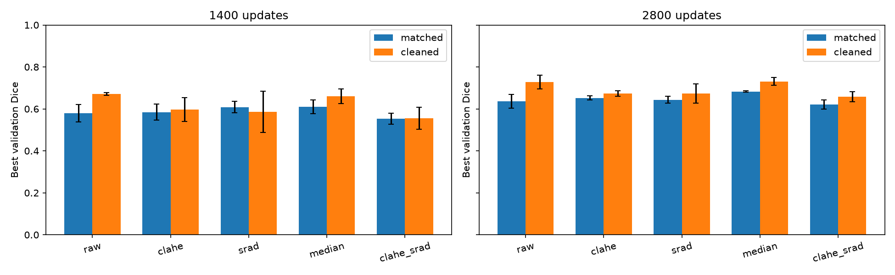
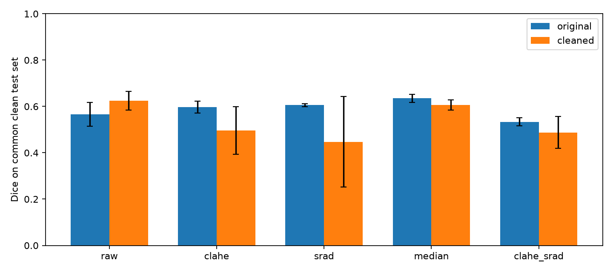
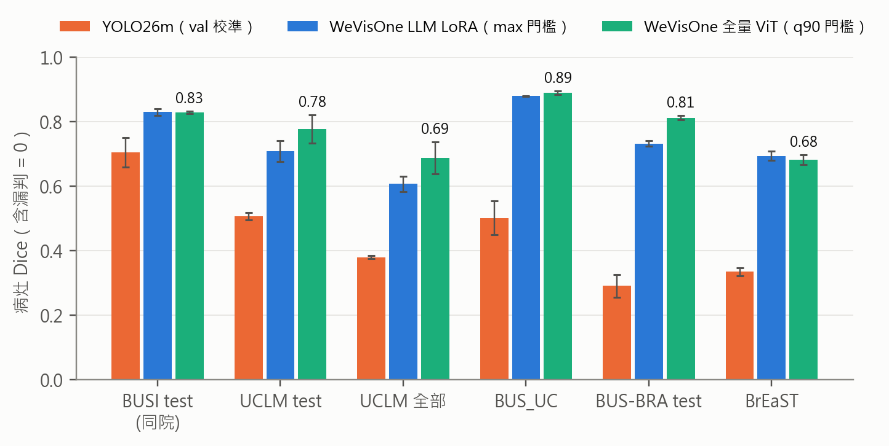

# 影像前處理對乳房超音波腫瘤分割的影響

**結論：在本次等樣本數、等類別數與等更新預算的驗證比較中，清理版五種方法的平均 Dice 均高於抽樣原版；中值濾波平均最高，但在清理版僅比原圖高 0.33 個百分點，尚不足以認定有穩定優勢。CLAHE→SRAD 沒有優於各自原圖。**

- **資料品質值得優先處理。** 2,800 次更新時，原圖的最佳驗證 Dice 為抽樣原版 **0.6360**、清理版 **0.7278**，相差 **9.18 個百分點**；這是固定一次抽樣下的觀察，不能視為普遍定論。
- **第一輪的訓練預算會影響排名。** 第一輪清理版訓練影像較少，同樣 40 epochs 只有 920 次更新，原版有 1,400 次；後續等樣本數實驗控制了這項差異。第一輪清理版 SRAD 落後的種子，最佳驗證 Dice 從約 0.1722 增至延長訓練後的 0.6274，不能僅憑初期低分判定方法無效。
- **驗證分數與測試分數必須分開。** 第二輪最高平均值 0.7311 是選模型用的最佳驗證 Dice；第一輪原版中值濾波的 0.6351 是測試 Dice，兩者不能直接相比並宣稱效能提升。

本專案為 G07 專題，依提案建立固定 U-Net 的 BUSI 分割比較，加入中值濾波、CLAHE→SRAD 與資料清理實驗。以下整理全部已完成的主要結果；原始 CSV、曲線與設定均可追溯。

WeVisOne-VL 的整理結果見本頁下方的[延伸研究](#延伸研究wevisone-vl-4b-跨機構乳房超音波病灶分割)。延伸實驗見 [WeVisOne-VL 提示詞初篩](results/wevisone_prompt_pilot/README.md)，比較五種提示對正常影像誤報與病灶 Dice 的影響。完整評估見 [WeVisOne-VL 與 YOLO、nnU-Net、MedSAM 的跨資料集比較](results/wevisone_vs_yolo/README.md)：涵蓋 BUSI、BUS-UCLM、BUS-BRA、BUS_UC、BrEaST 五個資料集、相同誤報率下的比較、失敗分解與審稿意見逐點回覆。

## 實驗總覽

| 實驗 | 訓練資料 | 訓練預算 | 評估與完成狀態 |
|---|---|---|---|
| 第一輪：固定 epoch | 全量原版 550 張／清理版 368 張 | 各 40 epochs，即 1,400／920 次更新 | 30 次訓練；共用 85 張乾淨驗證影像選模型，再評估共用 76 張乾淨測試影像 |
| 第二輪：等樣本數品質比較 | 分層抽樣原版 368 張／清理版 368 張 | 各 2,800 次更新，另保存 1,400 次結果 | 30 條訓練軌跡、60 份預算快照；只評估共用驗證集，不重新評估測試集 |
| 中途全量等更新診斷 | 全量原版／清理版 | 1,400、2,800 次更新 | 依需求轉向等樣本數比較，僅部分完成；保留紀錄，不當成完整比較 |

每個主要比較均為兩組資料 × 五種方法 × 三個訓練種子。第二輪沿用三條已完成且設定相同的清理版原圖軌跡，其餘 27 條重新執行；沿用來源寫在 metrics.json。兩個預算是同一條軌跡上的快照，不是 60 次獨立訓練。

## 第二輪：等樣本數與資料品質

**指標：共同 85 張乾淨驗證影像上的最佳驗證 Dice；數值為三個訓練種子的平均 ± 樣本標準差。這張表不是測試效能。**

兩組訓練集均為良性 207、惡性 112、正常 49，共 368 張。原版只從既定訓練分區按類別不放回抽樣，固定抽樣種子 2026；不重新切分驗證或測試影像。

| 前處理 | 1,400 次：抽樣原版 | 1,400 次：清理版 | 2,800 次：抽樣原版 | 2,800 次：清理版 |
|---|---:|---:|---:|---:|
| 原圖 | 0.5801 ± 0.0419 | 0.6714 ± 0.0064 | 0.6360 ± 0.0325 | 0.7278 ± 0.0329 |
| CLAHE | 0.5844 ± 0.0383 | 0.5962 ± 0.0570 | 0.6524 ± 0.0103 | 0.6743 ± 0.0131 |
| SRAD | 0.6085 ± 0.0275 | 0.5852 ± 0.0986 | 0.6433 ± 0.0165 | 0.6736 ± 0.0456 |
| 中值濾波 | 0.6100 ± 0.0338 | 0.6601 ± 0.0350 | 0.6824 ± 0.0034 | 0.7311 ± 0.0192 |
| CLAHE→SRAD | 0.5534 ± 0.0260 | 0.5556 ± 0.0523 | 0.6206 ± 0.0225 | 0.6585 ± 0.0244 |



2,800 次更新下，清理版相對抽樣原版的平均差異依序為：原圖 **+9.18**、CLAHE **+2.19**、SRAD **+3.03**、中值濾波 **+4.87**、CLAHE→SRAD **+3.79** 個百分點。1,400 次更新時，清理版 SRAD 尚低於抽樣原版；延長後排名反轉，顯示預算確實會影響比較。

清理版中值濾波 **0.7311 ± 0.0192** 與原圖 **0.7278 ± 0.0329** 的平均差僅約 0.0033；目前沒有顯著性檢定或足夠證據宣稱中值在清理版有可靠優勢。

雖然兩組同為 368 張，抽樣原版只有 **306 個已知影像群組**，清理版有 **368 個**；去重改變有效資訊量，是資料品質差異的一部分。兩組有 251 張訓練影像重疊，並非獨立資料來源；群組也不能當成病人數。

[完整報告](results/quality_matched/report.md) · [結果解讀與學習曲線](results/quality_matched/analysis.md) · [抽樣清單](results/quality_matched/sampled_original.csv) · [摘要 CSV](results/quality_matched/summary.csv)

## 第一輪：固定 40 epochs 的測試結果

**指標：共同 76 張乾淨測試影像上的影像平均，再跨三個種子平均；Dice／IoU 顯示平均 ± 樣本標準差。** 兩組都用相同 85 張乾淨驗證影像選最佳 epoch。

| 訓練資料 | 前處理 | 測試 Dice | 測試 IoU | 病灶 Dice | 正常影像偽陽性率 |
|---|---|---:|---:|---:|---:|
| 原版 | 原圖 | 0.5657 ± 0.0510 | 0.4655 ± 0.0505 | 0.6261 | 83.3% |
| 原版 | CLAHE | 0.5974 ± 0.0256 | 0.4933 ± 0.0245 | 0.6728 | 90.0% |
| 原版 | SRAD | 0.6057 ± 0.0067 | 0.5025 ± 0.0060 | 0.6925 | 96.7% |
| 原版 | 中值濾波 | 0.6351 ± 0.0170 | 0.5401 ± 0.0228 | 0.7213 | 93.3% |
| 原版 | CLAHE→SRAD | 0.5337 ± 0.0178 | 0.4230 ± 0.0242 | 0.5994 | 90.0% |
| 清理版 | 原圖 | 0.6250 ± 0.0399 | 0.5291 ± 0.0448 | 0.6641 | 63.3% |
| 清理版 | CLAHE | 0.4971 ± 0.1027 | 0.3873 ± 0.1111 | 0.5623 | 93.3% |
| 清理版 | SRAD | 0.4474 ± 0.1957 | 0.3584 ± 0.1579 | 0.4849 | 80.0% |
| 清理版 | 中值濾波 | 0.6058 ± 0.0221 | 0.5050 ± 0.0271 | 0.6723 | 83.3% |
| 清理版 | CLAHE→SRAD | 0.4879 ± 0.0686 | 0.3729 ± 0.0702 | 0.5619 | 100.0% |



第一輪原版以中值濾波最高，清理版以原圖最高；清理版原圖也高於原版原圖，因此不能概括為「清理版全面較差」。但兩組訓練張數與更新量不同，不能將所有差異單獨歸因於清理。28／30 次的最佳 epoch ≥35，12／30 次恰為 40，當時尚未確認收斂。

空標註且空預測的 Dice／IoU 定義為 1，因此另列病灶影像 Dice。正常影像只要出現任一陽性預測像素就算偽陽性；這個判準很嚴格，但結果也顯示正常影像處理仍需改善。

<details>
<summary>補充：各版本自身測試分區的平均 Dice</summary>

以下兩欄測試內容不同，只作各版本內部分數摘要；跨版本比較應以共同測試集為準。

| 前處理 | 原版測試分區：117 張 | 清理版測試分區：76 張 |
|---|---:|---:|
| 原圖 | 0.5425 | 0.6250 |
| CLAHE | 0.5489 | 0.4971 |
| SRAD | 0.5725 | 0.4474 |
| 中值濾波 | 0.5978 | 0.6058 |
| CLAHE→SRAD | 0.5159 | 0.4879 |

</details>

[完整報告與預測案例](results/busi/report.md) · [第一輪分析](results/busi/analysis.md) · [逐張測試分數](results/busi/per_image.csv) · [摘要 CSV](results/busi/summary.csv)

## 資料來源、清理與切分

BUSI 原版共 780 張；依已發表勘誤清單建立清理版，共 529 張。互斥排除原因為 duplicate 155、axilla 70、multiclass 19、needle 7；這是排除標記數，不等於所有可能重複的總數。保留正常影像及含文字／量測標記的影像，沒有依模型分數刪除難例，也未重新請醫師標註。

先合併作者標記的重複／近似群組與完全相同像素影像，再按群組類別約 70/15/15 切分，切分種子 2026。已知重複群組不跨分區，清理版是原版各分區的子集；原版保留資料內容，也採分組切分，並非允許重複影像跨區的隨機基準。

| 資料版本 | 訓練分區 | 驗證分區 | 測試分區 |
|---|---:|---:|---:|
| 全量原版 | 550 | 113 | 117 |
| 清理版 | 368 | 85 | 76 |
| 第二輪抽樣原版 | 368 | 共用清理版 85 張 | 保留共同 76 張，本輪不評分 |

第一輪主要比較實際只使用乾淨驗證／測試子集；第二輪只使用訓練與乾淨驗證影像，測試資料僅核對來源與分組，不進入前處理、訓練、推論或評分。沒有可用病人 ID，不能保證病人層級獨立。

## 訓練參數

| 項目 | 共用設定／兩輪差異 |
|---|---|
| 模型 | 從零訓練 U-Net，四次降採樣，channels 16/32/64/128/256，1,940,817 個參數；無預訓練、BatchNorm、Dropout |
| 輸入／遮罩 | 256×256 灰階；影像面積插值縮放，前處理後除以 255；所有同圖遮罩先取聯集，再以最近鄰縮放 |
| 最佳化器 | Adam，lr=0.001，betas=(0.9,0.999)，eps=1e-8，weight_decay=0 |
| 損失 | BCEWithLogitsLoss + (1 − 每張 soft Dice 的平均)，權重各 1，Dice smoothing=1 |
| 批次 | batch size=16，保留末批次；第二輪兩組每 epoch 恰為 23 個完整批次 |
| 第一輪預算 | 固定 40 epochs，原版 1,400 次、清理版 920 次更新；每 epoch 驗證 |
| 第二輪預算 | 固定 2,800 次更新，另存 1,400 次結果；兩組均約 60.87／121.74 epochs，每 35 次更新驗證 |
| 模型選擇 | 最佳驗證 hard Dice；閾值固定 0.5，無學習率排程與早停 |
| 訓練種子 | 42、43、44；同種子初始化相同。切分／第二輪抽樣種子均為 2026，使用各自獨立建立的隨機產生器 |
| 資料增強 | 僅訓練：隨機旋轉 ±10°、縮放參數 0.95–1.05、零填補；影像雙線性、遮罩最近鄰，同步幾何轉換；無上下翻轉、人工雜訊或亮度增強 |
| 執行環境 | RTX 5080、Python 3.13.15、PyTorch 2.11.0+cu128；FP32 張量、channels_last，啟用決定性演算法、cuDNN benchmark=False |

驗證／測試不做隨機資料增強。各方法的前處理都在資料增強之前進行；模型與前處理參數固定，未依測試分數重調。

| 方法 | 前處理設定 |
|---|---|
| raw | 只有共用縮放與正規化 |
| clahe | clip limit=2.0、8×8 tiles |
| srad | 20 iterations、step=0.5、全圖估計 q0 |
| median | 3×3 中值濾波 |
| clahe_srad | 先 CLAHE，再 SRAD；未加中值濾波 |

SRAD 使用瞬時變異係數與導流係數、四鄰域對稱面通量及無通量邊界。導流係數限制 [0,1]，更新係數為 step/4；零值先加 1/255，結束後扣回，不逐張重新拉伸。q0 每輪以全圖變異／平均平方估計，沒有人工均質 ROI，未宣稱與原論文所有實作細節相同。

[第二輪完整參數](results/quality_matched/parameters.md) · [第一輪設定](results/busi/config.json) · [套件完整版本](results/busi/environment.txt)

## 解讀限制與尚未完成的驗證

- 第二輪只有一份固定抽樣清單；種子 SD 不包含抽樣清單、病人或驗證影像的變異，不是信賴區間。
- 最佳驗證分數用來選模型，不能視為獨立泛化效能。較長預算也有更多選模型機會；兩個預算不是獨立實驗。
- 中值濾波可能降低細碎紋理，CLAHE 可能同時強化雜訊，SRAD 的全圖噪聲估計也可能不適合部分影像；這些是待驗證的機制，未經本專案消融實驗證實。
- 尚未逐項拆分去重／腋下／切片針／類別衝突的影響，也未做前處理參數搜尋、無資料增強對照、多次獨立抽樣或分組交叉驗證。
- 尚未保證收斂、病人獨立性或外部泛化；第一輪正常影像偽陽性偏高，第二輪沒有重新評估這項測試指標，不作臨床效能主張。

## 重現與檢查

Windows PowerShell，使用 Python 3.13 與 uv，所有命令從 repo 根目錄執行：

```powershell
uv venv --python 3.13 .venv
uv pip install --python .venv/Scripts/python.exe torch==2.11.0 --index-url https://download.pytorch.org/whl/cu128
uv pip install --python .venv/Scripts/python.exe -r requirements.txt
.venv/Scripts/python.exe prepare_data.py
.venv/Scripts/python.exe -m unittest -v

# 第一輪：含測試集評估
.venv/Scripts/python.exe -u experiment.py --output results/busi_reproduction

# 第二輪：等樣本數，只做驗證集評估，需要 CUDA GPU
.venv/Scripts/python.exe -u followup.py --matched --output results/quality_matched_reproduction
```

十一項測試通過，涵蓋濾波、指標、模型反向傳播、同步增強、資料配對與分組、抽樣類別數、更新預算、結果一致性及沿用來源欄位匯出。見 [第二輪檢查紀錄](results/quality_matched/validation.txt)。

資料下載採公開 Kaggle 鏡像並核對 ZIP SHA-256，來源變動時會停止。第一輪可用 CPU 執行但較慢；第二輪程式使用 CUDA。不同硬體或套件版本仍可能產生差異。

重現時請使用新的輸出目錄，避免混用已發表結果。相同設定重跑時，完成的單次訓練會略過；未完成者從頭重跑。設定或程式改變時必須另選 `--output`，資料修改後也不要沿用舊輸出目錄。第二輪新跑時會重新訓練全部組別，不自動複製本次沿用的快照。

## 結果檔案與追溯

| 位置 | 內容 |
|---|---|
| [results/quality_matched/](results/quality_matched/) | 第二輪報告、分析、完整參數、比較圖、學習曲線、抽樣清單、manifest、summary／runs CSV、設定與檢查紀錄 |
| [results/busi/](results/busi/) | 第一輪報告、分析、比較圖、預測案例、逐張測試分數、資料統計與完整環境版本 |
| [results/followup/STATUS.md](results/followup/STATUS.md) | 改為等樣本數比較前的部分全量診斷，未完成完整彙總；不併入主要結果 |
| 各結果目錄的 checkpoints/ | 各種子與預算的 history.csv、metrics.json；最佳模型權重僅留本機 |
| [metadata/](metadata/) | 勘誤作者逐張清單、授權、來源與 SHA-256 |

原始 BUSI 影像、ZIP、最佳模型權重及預測陣列均留在本機，不納入 Git；提案、程式、作者勘誤清單、統計結果與報告已上傳。第二輪沿用快照來源與匯出修正記錄見 metrics.json、config.json 及 export_provenance.json。圖表與學習曲線已目視檢查。

## 來源

- Al-Dhabyani et al. (2020), [Dataset of breast ultrasound images](https://doi.org/10.1016/j.dib.2019.104863)。
- [BUSI 原作者資料頁](https://scholar.cu.edu.eg/?q=afahmy/pages/dataset)；本次下載自 [Kaggle 公開鏡像](https://www.kaggle.com/datasets/aryashah2k/breast-ultrasound-images-dataset)，不重新散布原始影像。
- Pawłowska et al. (2023), [勘誤補充清單](https://doi.org/10.17632/k8t3gnx9h6.1)，CC BY 4.0；詳見 [metadata](metadata/README.md)。
- Yu & Acton (2002), [Speckle reducing anisotropic diffusion](https://doi.org/10.1109/TIP.2002.804276)。
- Ronneberger et al. (2015), [U-Net](https://arxiv.org/abs/1505.04597)。

---

# 延伸研究：WeVisOne-VL-4B 跨機構乳房超音波病灶分割

以上是影像前處理實驗（固定 U-Net）。本節是另一組實驗：只用同一份清理版 BUSI 訓練 368 張／驗證 85 張來微調 WeVisOne-VL-4B，與 YOLO26m-seg 等模型比較跨資料集表現。**兩組實驗的分數定義不同，不可直接相比**：上面多數表格的 Dice 含正常影像（空標註且空預測記 1），本節的「病灶 Dice」只計病灶影像，漏判記 0。

## 重點結論

- **訓練時沒看過的醫院資料上，WeVisOne 高於 YOLO26m。** 全量 ViT 微調版與 YOLO 都用 q90 門檻時，UCLM test 病灶 Dice 為 **0.777 vs 0.558**；五個外部評估集的差距為 +0.22 至 +0.42，配對 bootstrap 95% CI 全部大於 0。UCLM test 是 UCLM 全部的子集，兩者不是獨立驗證。
- **加入目標醫院的標註資料後，優勢消失。** 用 BUSI + BUS-BRA + UCLM train 訓練時，預先登錄的主要比較為 +0.013（95% CI −0.027 至 +0.051），依規則判定「未定論」：不能說贏，也不能正式說等價。原方法（LLM LoRA）在同類設定下低於 YOLO。
- **成本高很多。** 推論每張 729 ms、VRAM 11.1 GB；YOLO26m 為 10 ms、0.25 GB，約慢 76 倍。全量 ViT 訓練約需 29 GB VRAM。
- **新方法的 q90 門檻是看過測試結果後才選的。** 預先登錄的保留資料集 QAMEBI 通過三項標準，但它沒有正常影像，q90 對誤報率的影響仍未經獨立驗證。

## 方法

| 名稱 | ViT 影像編碼器 | 語言模型 | 像素 decoder | 有無病灶門檻 |
|---|---|---|---|---|
| 原方法（LLM LoRA） | 凍結 | LoRA r16 | 全部訓練 | max：13 張 BUSI val 正常影像分數的最大值 |
| 新方法（全量 ViT） | 全部微調 | LoRA r16 | 全部訓練 | q90：同一批分數的第 90 百分位 |

兩者都訓練 230 次更新、各 3 個種子（42/43/44），提示詞為 breast lesion。YOLO26m-seg 同樣 3 個種子。外部資料集為 BUS-UCLM、BUS-BRA、BUS_UC、BrEaST。

## 只用 BUSI 訓練

病灶 Dice，3 個種子平均。前兩欄兩邊門檻規則相同（q90）；後兩欄是原本預先指定的 max 門檻。

| 評估資料 | 全量 ViT（q90） | YOLO26m（q90） | 差值 [95% CI] | LLM LoRA（max） | YOLO26m（max） |
|---|---:|---:|---:|---:|---:|
| BUSI test（同來源） | 0.829 | 0.762 | +0.066 [+0.029, +0.110] | 0.829 | 0.704 |
| UCLM test | **0.777** | 0.558 | +0.219 [+0.137, +0.320] | 0.708 | 0.506 |
| UCLM 全部 | **0.687** | 0.449 | +0.238 [+0.187, +0.295] | 0.607 | 0.380 |
| BUS_UC | **0.889** | 0.606 | +0.283 [+0.261, +0.305] | 0.879 | 0.502 |
| BUS-BRA test | **0.812** | 0.392 | +0.420 [+0.381, +0.461] | 0.732 | 0.291 |
| BrEaST | 0.682 | 0.423 | +0.259 [+0.220, +0.297] | **0.694** | 0.335 |

UCLM test 的操作點（漏判指預測與標註完全沒有重疊）：

| 模型（門檻） | 病灶漏判率 | 正常影像誤報率 |
|---|---:|---:|
| 全量 ViT（q90） | 8.6% | 16.3% |
| YOLO26m（q90） | 34.5% | 25.0% |
| LLM LoRA（max） | 11.0% | 15.4% |
| YOLO26m（max） | 43.4% | 9.8% |



圖中的 YOLO 使用 max（val 校準）門檻，不是上表的 q90 公平比較。

- **差距主要來自有沒有找到病灶。** 原方法與 YOLO 都命中的 UCLM test 病灶，Dice 相近（0.881 vs 0.896）。惡性病灶（28 個）漏判率：全量 ViT q90 15.5%、LLM LoRA max 20.2%、YOLO max 78.6%。
- **YOLO 變體沒有追平原方法的點估計。** UCLM test 上，原方法比 YOLO26x 高 +0.186（Holm p = 0.0078），比加超音波強增強的 YOLO26m 高 +0.106（CI +0.025 至 +0.201，Holm p = 0.18，校正後不顯著）。
- **全量 ViT 相對原方法的提升主要在外部資料。** 兩者都用 q90 時，UCLM test +0.065、UCLM 全部 +0.078、BUS-BRA +0.079、BUS_UC +0.010（Holm p < 0.05）；BrEaST −0.017，不顯著。
- **門檻規則影響很大。** 全量 ViT 用 max 時，3 個種子中有 2 個在 UCLM test 漏判約 27–30%；四種規則的完整結果見 [GATE_RULES.md](results/wevisone_vs_yolo/GATE_RULES.md)。
- **BiomedParse v1（零樣本，1 次）** 套 max 門檻的 UCLM test 病灶 Dice 為 0.574；全量 ViT（q90）高 +0.203（CI +0.118 至 +0.308）。同來源 BUSI test 則是 0.812 vs 0.829，差異不顯著。BUSI 可能在它的訓練資料中。[完整表格](results/wevisone_vs_yolo/BIOMEDPARSE.md)
- **BrEaST 是全量 ViT 沒有進步的資料集。** 136 次漏判（病灶 × 種子）中有 112 次是模型判為無病灶；小病灶對兩種 WeVisOne 方法都困難。非典型病灶退步較多，推測與全量微調更貼近 BUSI 的病灶定義有關，尚未驗證。[錯誤分析](results/wevisone_vs_yolo/ERROR_BREAST.md)

## 多來源訓練（BUSI + BUS-BRA + UCLM train）

UCLM test，3 個種子，各來源使用自身驗證集的門檻。主要比較兩邊都用 q90，訓練前已[登錄協定](results/wevisone_vs_yolo/MS3_VITFULL_PREREG.md)。

| 模型（q90） | 病灶 Dice | 漏判率 | 正常影像誤報率 |
|---|---:|---:|---:|
| 全量 ViT | 0.785 ± 0.025 | 12.6% | 5.9% |
| YOLO26m | 0.771 ± 0.026 | 9.3% | 15.1% |
| LLM LoRA | 0.684 ± 0.045 | 21.7% | 4.4% |
| 全量 ViT + UCLM 病灶影像重複 3 次（探索性） | 0.828 ± 0.021 | 8.6% | 4.3% |

- 全量 ViT − YOLO：Dice +0.013（−0.027 至 +0.051），**未定論**；誤報率低 9.2 個百分點。改用 max 門檻（次要分析）則為 +0.037（+0.002 至 +0.063）。
- 沒參與訓練的 BUS_UC、BrEaST 上，q90 的全量 ViT 比 YOLO 高 +0.041、+0.063。
- 重複抽樣版是看過先前結果後提出的假設，只能當探索性結果。

[完整結果](results/wevisone_vs_yolo/MS3_VITFULL.md)

## 預先登錄的保留資料測試（QAMEBI）

門檻與成功標準在下載資料前[寫定](results/wevisone_vs_yolo/HOLDOUT_PREREG.md)。QAMEBI 共 232 張病灶 ROI 裁切影像，沒有正常影像。

| 模型（門檻） | 病灶 Dice | 漏判率 |
|---|---:|---:|
| 全量 ViT（q90，主要分析） | 0.840 ± 0.011 | 3.0% |
| 全量 ViT（max） | 0.794 ± 0.048 | 8.9% |
| LLM LoRA（max） | 0.827 ± 0.017 | 3.0% |
| YOLO26m（val 校準） | 0.504 ± 0.054 | 41.2% |
| BiomedParse（零樣本，max，1 次） | 0.698 | 20.7% |

三項標準全部通過：各種子漏判 ≤ 20%；不劣於原方法（+0.013，CI −0.001 至 +0.028，沒有顯著較好）；優於 YOLO（+0.336，CI +0.290 至 +0.381）。[完整結果](results/wevisone_vs_yolo/HOLDOUT.md)

## 本節限制

- q90 屬事後選擇，且只由 13 張 BUSI val 正常影像估計；多來源 BUSI + BUS-BRA 的 q90 結果同樣是事後分析。
- 本節的信賴區間只反映固定模型與門檻下的抽樣不確定性，不含重新訓練與重新校準。UCLM test 只有 18 位病人；沒有病人 ID 的資料集以影像或群組抽樣。
- BUSI test 只有 10 張正常影像、BrEaST 只有 4 張，這兩者的誤報率只能參考。
- WeVisOne 未公開預訓練資料清單，無法排除看過公開乳房超音波資料。
- 調參投入不對等：WeVisOne 試過的變體較多，新方法是看過測試結果後選出的。

## 詳細報告

- [完整比較報告](results/wevisone_vs_yolo/README.md)：資料切分、指標定義、失敗分解、嚴格定位 F1、交叉驗證、少量資料、壓力測試與審稿意見回覆（更新至 2026-11-20；上述多來源全量 ViT、QAMEBI、BiomedParse、BrEaST 分析在其後完成，以本節和各連結為準）。
- [自動產生的數據表](results/wevisone_vs_yolo/REPORT.md) · [8 頁圖表 PDF](results/wevisone_vs_yolo/WeVisOne_實驗報告.pdf) · [提示詞初篩](results/wevisone_prompt_pilot/README.md)
