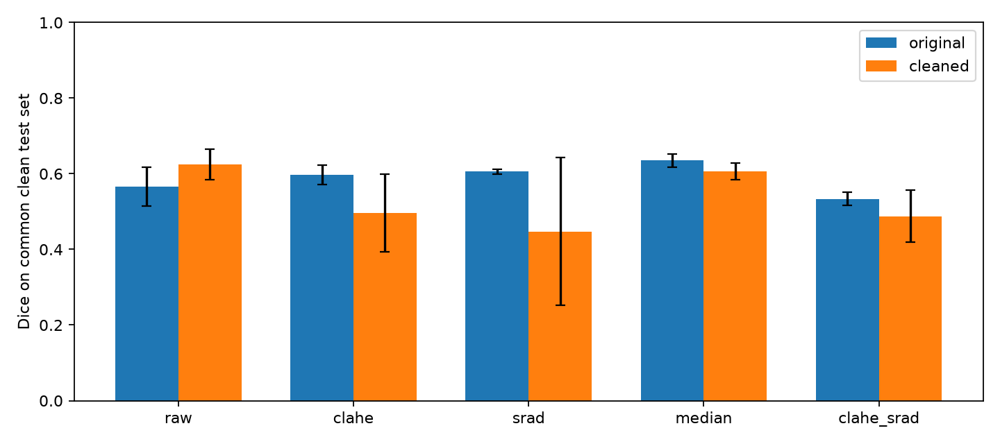
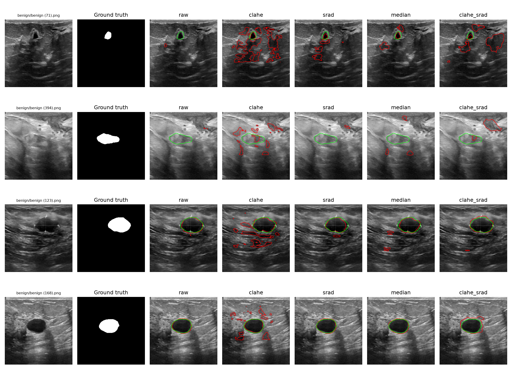

# BUSI 前處理與資料清理比較

本報告為實際執行結果，非文獻數值或模擬資料。

共 30 次訓練；每次 40 epochs；訓練種子 [42, 43, 44]。
兩版本均在相同的乾淨驗證集選最佳 epoch，以下主表使用相同乾淨測試集。

| 訓練資料 | 前處理 | Dice（種子平均 ± SD） | IoU（種子平均 ± SD） | 病灶 Dice | 正常影像偽陽性率 |
|---|---|---:|---:|---:|---:|
| original | raw | 0.5657 ± 0.0510 | 0.4655 ± 0.0505 | 0.6261 | 0.8333 |
| original | clahe | 0.5974 ± 0.0256 | 0.4933 ± 0.0245 | 0.6728 | 0.9000 |
| original | srad | 0.6057 ± 0.0067 | 0.5025 ± 0.0060 | 0.6925 | 0.9667 |
| original | median | 0.6351 ± 0.0170 | 0.5401 ± 0.0228 | 0.7213 | 0.9333 |
| original | clahe_srad | 0.5337 ± 0.0178 | 0.4230 ± 0.0242 | 0.5994 | 0.9000 |
| cleaned | raw | 0.6250 ± 0.0399 | 0.5291 ± 0.0448 | 0.6641 | 0.6333 |
| cleaned | clahe | 0.4971 ± 0.1027 | 0.3873 ± 0.1111 | 0.5623 | 0.9333 |
| cleaned | srad | 0.4474 ± 0.1957 | 0.3584 ± 0.1579 | 0.4849 | 0.8000 |
| cleaned | median | 0.6058 ± 0.0221 | 0.5050 ± 0.0271 | 0.6723 | 0.8333 |
| cleaned | clahe_srad | 0.4879 ± 0.0686 | 0.3729 ± 0.0702 | 0.5619 | 1.0000 |

## 清理的配對差異

同一方法、同一種子配對：cleaned − original；單位為 Dice 百分點。

- raw: 平均 +5.93；各種子 +1.39, +9.40, +7.00
- clahe: 平均 -10.03；各種子 -22.43, -3.83, -3.85
- srad: 平均 -15.83；各種子 -5.08, -37.79, -4.63
- median: 平均 -2.94；各種子 -7.04, -2.51, +0.74
- clahe_srad: 平均 -4.57；各種子 -0.27, -0.56, -12.90

## 成功與失敗案例

固定取 cleaned/raw 第一個種子的病灶測試集兩個最低與兩個最高 Dice 案例；紅線為預測，綠線為標註。其他方法展示相同影像，未各自挑選最佳案例。

## 解讀限制

- 使用作者勘誤群組及完全相同像素雜湊分組；沒有病人識別碼，不能宣稱病人層級獨立。
- 清理版排除作者標記 axilla、needle、multiclass 群組，重複群組保留清單第一張；保留正常影像與含文字／量測標記的影像。未重新請醫師標註。
- 原版保留全部 780 張，但採分組切分；不是會讓重複影像跨區的天真隨機基準。
- 兩版 epoch 數一致，但訓練資料量不同，因此最佳化更新次數不同；效果同時包含資料清理與樣本數變化。
- SD 是固定一次切分下的訓練種子變異，不是病人層級信賴區間或顯著性證據。
- 閾值固定 0.5；空標註且空預測的 Dice/IoU 定義為 1；正常影像只要預測任一陽性像素即計為偽陽性。
- 未做超參數搜尋、交叉驗證或外部資料驗證；不作臨床診斷用途。

詳細設定見 config.json、資料數量見 dataset_stats.json、逐張結果見 per_image.csv。

資料清理依據：[Pawłowska 等人補充資料（CC BY 4.0）](https://doi.org/10.17632/k8t3gnx9h6.1)。
