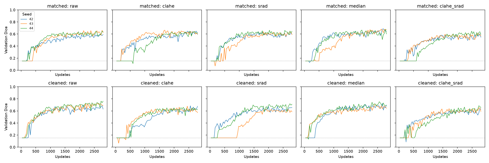

# 等樣本數後，資料清理是否有幫助？

本輪完成兩種訓練資料 × 五種方法 × 三個種子，共 30 條訓練軌跡、60 份預算快照；其中清理版原圖的三條軌跡沿用先前已完成且設定相同的訓練，來源逐份記錄。
**以下是共同 85 張乾淨驗證影像上的最佳驗證 Dice，不是獨立測試效能。**

## 2,800 次更新的主要結果

| 前處理 | 抽樣原版 | 清理版 | 清理版 − 抽樣原版（百分點） |
|---|---:|---:|---:|
| 原圖 | 0.6360 ± 0.0325 | 0.7278 ± 0.0329 | +9.18 |
| CLAHE | 0.6524 ± 0.0103 | 0.6743 ± 0.0131 | +2.19 |
| SRAD | 0.6433 ± 0.0165 | 0.6736 ± 0.0456 | +3.03 |
| 中值濾波 | 0.6824 ± 0.0034 | 0.7311 ± 0.0192 | +4.87 |
| CLAHE→SRAD | 0.6206 ± 0.0225 | 0.6585 ± 0.0244 | +3.79 |

數字為三個訓練種子的平均 ± 樣本標準差。完整兩個預算的表格見 [report.md](report.md)。

本次固定抽樣下，清理版在五種方法的平均驗證分數都較高。控制張數、類別比例與更新量後，結果支持清理規則有益的推測，但尚不能把它視為普遍的資料品質定論。

中值濾波在兩組的平均值仍最高；清理版中值 0.7311 與原圖 0.7278 只差 **0.33 個百分點**，遠小於各自種子 SD，不能宣稱中值在清理版有可靠優勢。CLAHE→SRAD 仍沒有超過各自原圖。

## 訓練預算確實會改變比較

1,400 次更新時，清理版 SRAD 平均為 0.5852，低於抽樣原版的 0.6085；延長至 2,800 次則成為 0.6736 對 0.6433。
清理版 SRAD 種子 43 在第一輪 920 次更新時，最佳驗證 Dice 約 0.1722，本輪延長後為 0.6274。因此第一輪低分不足以斷言 SRAD 本身有害。

曲線是每次驗證的實際值；灰色虛線為全部預測背景的基準 13/85≈0.153。曲線仍有波動，2,800 次只是本輪預算上限，未保證收斂。
兩個預算來自同一條軌跡；較長預算有更多驗證及選模型機會，不能將它們當成獨立實驗，也不能只依最佳驗證分數增加就斷言測試效能提升。

## 抽樣控制了什麼

- 只從既定原版訓練分區不放回抽樣，固定種子 2026；兩組均為良性 207、惡性 112、正常 49，共 368 張。
- batch=16，每個 epoch 恰好 23 個完整批次；更新次數與訓練影像曝光總次數皆相同。1,400／2,800 次更新分別曝光 22,400／44,800 張次。
- 固定模型、增強、損失、學習率、驗證頻率及驗證影像，並用相同三個訓練種子。
- 兩組訓練影像有 251 張重疊。抽樣原版含 306 個已知影像群組、清理版含 368 個；去重改變有效資訊量，這是資料品質差異的一部分。群組不能當成病人數。
- 原清理規則會排除抽樣原版其中 117 張；其中被標為 duplicate 的影像未必在本次子集中仍有另一份副本，不能直接將排除標記數當成子集內的重複張數。

## 限制與驗證

目前只有一份抽樣清單；三個訓練種子的 SD 沒有涵蓋抽樣變異、病人變異或驗證集抽樣誤差，也未進行顯著性檢定。
尚未逐項消融去重／腋下／切片針／類別衝突，也未搜尋前處理參數。不能從本輪判定哪一項清理最有效。
本輪只核對測試資料的來源與分組，不作測試前處理、訓練、推論或評分；正常影像偽陽性問題尚未在本輪獨立評估。

十一項測試通過，包括等類別數抽樣、沒有 holdout 混入、精確更新預算、沿用來源欄位匯出，以及 60 份結果／驗證曲線一致性。見 [validation.txt](validation.txt)。比較圖與學習曲線已目視檢查。
新訓練程式版本為 commit `8d02930`；沿用的三條原圖軌跡另見來源 config。後續僅修正彙整來源欄位格式，未更動訓練迴圈。來源雜湊見 config.json 與 export_provenance.json。
