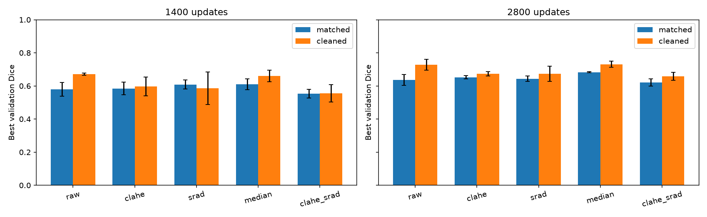

# 等更新次數與延長訓練：驗證集結果

本輪未執行測試集推論；以下都是用來選模型的驗證集分數，不能視為測試效能。

| 更新次數 | 訓練版本 | 方法 | 最佳驗證 Dice（種子平均 ± SD） |
|---:|---|---|---:|
| 1400 | matched | raw | 0.5801 ± 0.0419 |
| 1400 | matched | clahe | 0.5844 ± 0.0383 |
| 1400 | matched | srad | 0.6085 ± 0.0275 |
| 1400 | matched | median | 0.6100 ± 0.0338 |
| 1400 | matched | clahe_srad | 0.5534 ± 0.0260 |
| 1400 | cleaned | raw | 0.6714 ± 0.0064 |
| 1400 | cleaned | clahe | 0.5962 ± 0.0570 |
| 1400 | cleaned | srad | 0.5852 ± 0.0986 |
| 1400 | cleaned | median | 0.6601 ± 0.0350 |
| 1400 | cleaned | clahe_srad | 0.5556 ± 0.0523 |
| 2800 | matched | raw | 0.6360 ± 0.0325 |
| 2800 | matched | clahe | 0.6524 ± 0.0103 |
| 2800 | matched | srad | 0.6433 ± 0.0165 |
| 2800 | matched | median | 0.6824 ± 0.0034 |
| 2800 | matched | clahe_srad | 0.6206 ± 0.0225 |
| 2800 | cleaned | raw | 0.7278 ± 0.0329 |
| 2800 | cleaned | clahe | 0.6743 ± 0.0131 |
| 2800 | cleaned | srad | 0.6736 ± 0.0456 |
| 2800 | cleaned | median | 0.7311 ± 0.0192 |
| 2800 | cleaned | clahe_srad | 0.6585 ± 0.0244 |

參數見 [parameters.md](parameters.md)、config.json；逐次訓練見 runs.csv 與 checkpoints/ 下的 history.csv。

固定更新次數不代表完全相同的影像曝光量：保留各 epoch 最後一個不足 batch 的批次。2,800 次仍是預算上限，不保證已收斂。增加驗證次數也會增加選模型的機會，1,400／2,800 分數不是獨立重複實驗。
