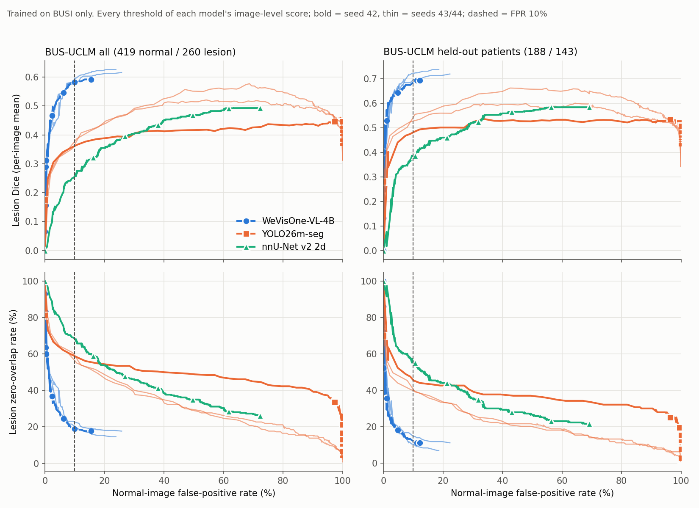

# WeVisOne-VL-4B 與 YOLO、nnU-Net、MedSAM 的乳房超音波病灶分割比較

> 狀態：**期中版本（2026-11-14）**。第 1–9 節的實驗已完成；第 10 節列出仍在 GPU 佇列中執行的實驗（強資料增強、合成干擾壓力測試、5 折交叉驗證、少量資料、多來源訓練、YOLO 框 + WeVisOne decoder 混合、BUS-BRA→BUSI 的 nnU-Net），完成後會更新本頁同一份報告。

## 結論

所有模型只用清理後的 BUSI 訓練集（368 張）訓練，閾值只用 BUSI 驗證集（85 張，其中 13 張正常）決定。

1. **BUSI 內部測試沒有拉開差距。** 病灶 Dice：WeVisOne 0.829 ± 0.010（3 seeds），nnU-Net 0.823，YOLO26m-seg 0.774 ± 0.005（conf 0.25）。測試集只有 10 張正常影像，正常影像誤報率在 0/10 到 5/10 之間跳動，不足以排名。
2. **差距出現在外部資料，且主要來自「找到病灶」這一步，不是像素分割。** 在 BUS-UCLM（38 位病人、419 張正常、260 張病灶），把正常影像誤報率壓到 ≤10% 時：
   - WeVisOne 病灶 Dice **0.582 ± 0.006**，零重疊率 20.9%
   - YOLO 0.353 ± 0.002，零重疊率 60.4%
   - nnU-Net 0.253，零重疊率 68.8%

   病人層級配對 bootstrap 的 Dice 差值（WeVisOne 閘門 vs YOLO 校準）為 +0.227 [95% CI +0.169, +0.295]。
3. **給正確的框，三種 decoder 都分得很好。** 用 GT 框提示時，WeVisOne decoder 在 UCLM 的病灶 Dice 為 0.908，MedSAM 為 0.784；端到端 WeVisOne 只有 0.592。外部落差的大部分在偵測／定位，而不在 mask 品質。
4. **WeVisOne 的格式錯誤為 0。** 在所有資料集與 seed 中，沒有任何一筆輸出無法解析（malformed 0/N）。失敗只有兩種：框到錯的地方（UCLM 15–17%），或判為無病灶（UCLM 6–12%）。YOLO 的主要失敗是完全沒有偵測（UCLM 校準閾值下 49–56%）。
5. **YOLO 在 UCLM 的誤報大多來自掃描儀的身體標記圖示（body-mark icon）。** conf 0.25 下，3 個 seed 共 559/1257 次正常影像誤報，只落在右下角圖示區域的偵測移除後剩 346 次。WeVisOne 也受影響，但程度較小：18.9% → 16.5%。
6. **「+None」提示詞的改善無法在 3 個 seed 重現。** seed 42 在 UCLM 的誤報由 65/419 降至 53/419，但 3 個 seed 合計反而由 273/1257 升到 325/1257（未加閘門）；BUS-BRA 與 BrEaST 的病灶 Dice 也下降。這個提示詞是看過 UCLM 錯誤後才提出的，結論只能算探索性，**不建議採用**。
7. **論文數字對不上的原因已找到。** 依 Yu et al. 2026（QIMS）的設定重現（未清理的 647 張 BUSI 病灶影像、影像層級隨機 80/10/10、yolo11n-seg），BUSI 測試的逐張 Dice 為 0.74–0.80。其中與訓練集有重複組的測試影像為 0.79–0.87，沒有重複的只有 0.71–0.78。UCLM 若用彙總 Dice（pooled）是 0.62–0.70，與論文的 0.69 相符，但同一模型在 UCLM 正常影像的誤報率高達 33–73%，論文沒有報告。

## 1. 資料與切分

| 資料集 | 用途 | 影像數 | 正常 / 病灶 | 切分方式 |
|---|---|---:|---|---|
| BUSI（清理版） | 訓練 / 驗證 / 測試 | 368 / 85 / 76 | 測試 10 / 66 | 沿用本 repo 的清理與切分：依勘誤表與像素重複群組分組，同組不跨分區 |
| BUS-UCLM v3 | 外部測試 | 679（38 位病人） | 419 / 260 | `uclm:all` 全部；`uclm:test` 為固定的 18 位病人（331 張：188 / 143），保留給多來源實驗 |
| BUS-BRA（Zenodo 8231412） | 外部測試 | 測試 374 | 0 / 374 | 依病例 70/10/20 切分，只評估測試 20% |
| BUS_UC（Mendeley 3ksd7w7jkx） | 外部測試 | 811 | 0 / 811 | 全部 |
| BrEaST（TCIA） | 外部測試 | 256 | 4 / 252 | 全部；GT 只取 `*_tumor.png` |

- 以 32×32 縮圖的餘弦相似度篩查近似重複：BUS_UC、BUS-BRA、BrEaST 與 BUSI、UCLM、BUS-BRA 之間，沒有相似度 > 0.95 的配對。
- BUS_UC 有 2 張影像與遮罩尺寸不一致：`benign/0319` 為 256×256 vs 256×257，`malignant/0049` 為 250×256 vs 200×205。所有模型都把預測與 GT 各自縮放到 256×256 再評分，影響 2/811 張，對各模型相同。

## 2. 指標定義

所有指標在 256×256 計算：機率圖以雙線性縮放後取 > 0.5。

| 指標 | 定義 |
|---|---|
| 正常影像誤報率（FPR） | 正常影像中，預測出任何前景像素的比例；一律附 k/N |
| 病灶 Dice | 只對病灶影像逐張計算後取平均（per-image mean），空預測記為 0 |
| 零重疊率（zero-overlap） | 病灶影像中，預測與 GT 完全沒有交集的比例（含空預測）；一律附 k/N |
| AUROC | 用影像層級分數區分正常與病灶影像。WeVisOne：第一個病灶 token 與 `None` 的 logit 差；YOLO：最高偵測信心；nnU-Net：最大前景機率 |

舊版報告中的「0% miss」指的是「病灶影像都有輸出遮罩」，不代表都有打中。同一模型的零重疊率是 1/66。本報告不再使用「miss」一詞描述空預測，一律分開報告空預測與零重疊。

## 3. 模型與閾值

| 模型 | 訓練設定 | 影像層級閾值（只用 BUSI 驗證集） |
|---|---|---|
| WeVisOne-VL-4B | LLM 加 LoRA r=16，pixel decoder 全部參數微調，230 steps，seeds 42/43/44 | raw：直接用模型輸出；gate：presence score 必須嚴格大於驗證集正常影像的最大分數 |
| YOLO26m-seg（ultralytics 8.4.212） | 150 epochs，patience 40，imgsz 640，batch 16，deterministic，seeds 42/43/44 | 0.25：Ultralytics 預設；cal：嚴格大於驗證集正常影像的最大信心 |
| nnU-Net v2 2d | `nnUNetTrainer_250epochs`，fold 0 即我們的 train/val（`splits_final.json`），1 次訓練 | raw；gate：最大前景機率嚴格大於驗證集正常影像的最大值 |
| MedSAM（`wanglab/medsam-vit-base`） | 零樣本，不微調 | 只當作框提示 decoder 使用 |

MedSAM 的前處理先在驗證集比較：官方 [0,1] 輸入的 GT 框 Dice 為 0.705，ImageNet 正規化為 0.906，因此採用後者。決定只看驗證集。

## 4. 主要結果：只用 BUSI 訓練

WeVisOne 與 YOLO 為 3 seeds 的平均 ± SD，k/N 為 3 seeds 加總；nnU-Net 只有 1 次訓練。

| 模型 | BUSI 測試 FPR | BUSI 病灶 Dice | UCLM 全部 FPR | UCLM 病灶 Dice | UCLM 零重疊 | UCLM AUROC |
|---|---:|---:|---:|---:|---:|---:|
| WeVisOne raw | 46.7% (14/30) | 0.829 ± 0.010 | 21.7% (273/1257) | 0.611 ± 0.017 | 16.7% (130/780) | 0.937 ± 0.007 |
| WeVisOne + gate | 40.0% (12/30) | 0.829 ± 0.010 | 18.9% (237/1257) | 0.607 ± 0.023 | 17.4% (136/780) | 0.937 ± 0.007 |
| YOLO conf 0.25 | 16.7% (5/30) | 0.774 ± 0.005 | 44.5% (559/1257) | 0.476 ± 0.070 | 40.5% (316/780) | 0.731 ± 0.015 |
| YOLO 驗證校準 | 0.0% (0/30) | 0.704 ± 0.045 | 12.7% (160/1257) | 0.380 ± 0.005 | 56.3% (439/780) | 0.731 ± 0.015 |
| nnU-Net raw | 30.0% (3/10) | 0.823 | 72.3% (303/419) | 0.493 | 26.2% (68/260) | 0.681 |
| nnU-Net + gate | 0.0% (0/10) | 0.642 | 4.1% (17/419) | 0.156 | 81.5% (212/260) | 0.681 |

只有病灶影像的外部資料集（raw 輸出；BrEaST 另有 4 張正常影像）：

| 模型 | BUS_UC 病灶 Dice | BUS_UC 零重疊 | BUS-BRA 病灶 Dice | BUS-BRA 零重疊 | BrEaST 病灶 Dice | BrEaST 零重疊 | BrEaST 正常誤報 |
|---|---:|---:|---:|---:|---:|---:|---:|
| WeVisOne | 0.880 ± 0.001 | 0.9% (22/2433) | 0.733 ± 0.009 | 4.4% (49/1122) | 0.701 ± 0.011 | 13.2% (100/756) | 5/12 |
| YOLO 0.25 | 0.625 ± 0.021 | 19.4% (473/2433) | 0.398 ± 0.089 | 48.8% (547/1122) | 0.443 ± 0.076 | 45.2% (342/756) | 4/12 |
| nnU-Net | 0.819 | 0.9% (7/811) | 0.677 | 11.8% (44/374) | 0.554 | 28.6% (72/252) | 2/4 |

UCLM 測試病人子集（`uclm:test`，331 張）的結論相同：WeVisOne raw 病灶 Dice 0.716、YOLO 0.583、nnU-Net 0.584。完整欄位見 [附錄 REPORT.md](REPORT.md)。

nnU-Net 在 BUSI 內部與 WeVisOne 幾乎相同，但外部正常影像誤報率達 69–72%。用驗證集校準的閘門壓低誤報後，病灶也大量消失。最大前景機率並不是為「有無病灶」設計的分數，這是 nnU-Net 閘門偏弱的可能原因之一，詳見第 11 節。

## 5. 在相同誤報率下比較病灶表現

為了避免「一個模型誤報低、另一個 Dice 高」無法比較，對每個模型掃過影像層級分數的所有閾值，取 FPR ≤ 5% / 10% / 15% 時最好的病灶 Dice。這些閾值是在測試集上掃出來的，**只用於分析，不是可部署的規則**。

| 資料集 | 模型 | FPR ≤ 5%：Dice / 零重疊 | FPR ≤ 10% | FPR ≤ 15% |
|---|---|---|---|---|
| UCLM 全部 | WeVisOne（3 seeds） | 0.527 ± 0.014 / 29.9% | **0.582 ± 0.006 / 20.9%** | 0.603 ± 0.011 / 17.9% |
| UCLM 全部 | YOLO（3 seeds） | 0.316 ± 0.009 / 65.1% | 0.353 ± 0.002 / 60.4% | 0.390 ± 0.015 / 55.0% |
| UCLM 全部 | nnU-Net（1 run） | 0.160 / 81.2% | 0.253 / 68.8% | 0.315 / 60.0% |
| UCLM 測試病人 | WeVisOne | 0.658 ± 0.010 / 18.4% | **0.698 ± 0.022 / 12.8%** | 0.710 ± 0.019 / 10.7% |
| UCLM 測試病人 | YOLO | 0.466 ± 0.027 / 48.7% | 0.500 ± 0.025 / 44.5% | 0.528 ± 0.031 / 40.6% |
| UCLM 測試病人 | nnU-Net | 0.314 / 63.6% | 0.386 / 55.2% | 0.429 / 48.3% |



上排是病灶 Dice、下排是零重疊率，橫軸為正常影像誤報率。WeVisOne 的曲線停在 FPR 約 15–25%，因為即使不設閘門，它在多數正常影像上也會輸出 `None`。YOLO 與 nnU-Net 必須接受很高的誤報率，Dice 才追得上。

### 病人層級配對 bootstrap（A − B，5,000 次，以病人為重抽單位）

| 資料集 | 比較 | 影像 / 病人 | ΔFPR（百分點）[95% CI] | Δ病灶 Dice [95% CI] |
|---|---|---:|---:|---:|
| UCLM 全部 | WeVisOne gate vs YOLO 校準 | 679 / 38 | +6.1 [+1.3, +11.1] | +0.227 [+0.169, +0.295] |
| UCLM 全部 | WeVisOne raw vs YOLO 0.25 | 679 / 38 | −22.8 [−27.9, −17.3] | +0.135 [+0.080, +0.198] |
| UCLM 測試病人 | WeVisOne gate vs YOLO 校準 | 331 / 18 | +5.7 [−0.3, +12.5] | +0.202 [+0.116, +0.313] |
| UCLM 測試病人 | WeVisOne raw vs YOLO 0.25 | 331 / 18 | −22.5 [−29.3, −15.6] | +0.133 [+0.050, +0.238] |
| BUS_UC | WeVisOne gate vs YOLO 校準 | 811 / 811 | – | +0.378 [+0.352, +0.403] |

在各自的驗證集閾值下，WeVisOne 的誤報率比校準後的 YOLO 高約 6 個百分點，但病灶 Dice 高 0.2 以上。兩者的取捨不同，這也是第 5 節要在相同誤報率下比較的原因。

## 6. 端到端失敗分解

把每張病灶影像依輸出分類。WeVisOne 從回應文字解析 `<box>` 座標；YOLO 使用偵測框。分類依據是與 GT 框的最大 IoU：

- none：沒有輸出
- malformed：格式無法解析
- off：IoU < 0.1
- partial：介於 off 與 hit 之間
- hit：IoU ≥ 0.5

括號內為該類的平均 Dice。

| 資料集 | 模型 | none | malformed | off | partial | hit | 框 recall@0.5 |
|---|---|---:|---:|---:|---:|---:|---:|
| BUSI 測試（66） | WeVisOne s42 | 0 | 0 | 3 (0.03) | 4 (0.48) | 59 (0.90) | 0.894 |
| BUSI 測試 | YOLO s42 校準 | 9 | 0 | 2 (0.02) | 1 (0.53) | 54 (0.90) | 0.818 |
| UCLM 全部（260） | WeVisOne s42 / s43 / s44 | 31 / 15 / 22 | 0 / 0 / 0 | 38 / 45 / 43 | 31 / 30 / 27 | 160 / 170 / 168 | 0.58–0.61 |
| UCLM 全部 | YOLO s42 / s43 / s44 校準 | 128 / 146 / 141 | 0 | 16 / 4 / 6 | 7 / 2 / 8 | 109 / 108 / 105 | 0.39–0.40 |
| BUS-BRA（374） | WeVisOne s42 | 0 | 0 | 37 (0.05) | 64 (0.56) | 273 (0.88) | 0.730 |
| BUS-BRA | YOLO s42 校準 | 251 | 0 | 2 | 9 | 112 (0.88) | 0.299 |
| BrEaST（252） | WeVisOne s42 | 24 | 0 | 14 | 31 | 183 (0.88) | 0.726 |
| BrEaST | YOLO s42 校準 | 149 | 0 | 3 | 9 | 91 (0.89) | 0.361 |

- 只要框打中（hit），兩個模型的 Dice 都在 0.88–0.91，mask 品質差不多。
- 外部資料上，YOLO 的損失幾乎都來自「沒有偵測」。WeVisOne 的損失分散在「框錯位置」與「判為無病灶」兩類。
- 完整表格（含 conf 0.25、所有 seed 與資料集、計數錯誤率、各類別佔的 Dice 損失）：[FAILURES.md](FAILURES.md)。

## 7. 語言介面的貢獻：同一組框，不同 decoder

| 資料集 | MedSAM + GT 框 | WeVisOne decoder + GT 框 | MedSAM + YOLO 校準框 | WeVisOne 端到端 | YOLO 校準端到端 |
|---|---:|---:|---:|---:|---:|
| BUSI 測試 | 0.872 | 0.919 | 0.681 | 0.833 | 0.704 |
| UCLM 全部 | 0.784 | 0.908 | 0.355 | 0.592 | 0.380 |
| UCLM 測試病人 | 0.805 | 0.924 | 0.473 | 0.693 | 0.506 |
| BUS_UC | 0.899 | 待補 | 待補 | 0.880 | 0.502 |
| BUS-BRA | 0.845 | 待補 | 待補 | 0.733 | 0.291 |

WeVisOne 端到端的 BUSI 與 UCLM 兩列為 seed 42，其餘欄位為 3 seeds 平均。

- **給相同的 GT 框**，經 BUSI 微調的 WeVisOne decoder 比零樣本 MedSAM 高 0.05–0.12。但 MedSAM 沒有在 BUSI 上微調，這一欄比較的是「微調過的 decoder」與「通用 decoder」，不是架構優劣。
- **給相同的 YOLO 框**，MedSAM 在 UCLM 只有 0.355，幾乎等於 YOLO 自己的 0.380。換 decoder 救不了偵測失敗。
- WeVisOne 端到端（0.592）明顯高於任何「YOLO 框 + decoder」組合（≤ 0.380）。在本實驗中，WeVisOne 的優勢主要來自**語言模型產生的框與有無病灶的判斷**，不是 decoder。
- 「YOLO 框 → WeVisOne decoder」的混合實驗仍在佇列中（第 10 節），完成後可以進一步分開 decoder 與定位的貢獻。

## 8. 零樣本與微調、預訓練曝光

WeVisOne 的 repo 沒有公開預訓練資料清單，**無法排除它看過 BUSI 或其他公開乳房超音波資料**。我們能做的是比較零樣本與微調後的表現。

| 資料集 | 零樣本 病灶 Dice | 微調後（3 seeds） | 零樣本 零重疊 | 微調後 零重疊 | 零樣本 正常誤報 |
|---|---:|---:|---:|---:|---:|
| BUSI 測試 | 0.700 | 0.829 ± 0.010 | 2/66 | 3/198 | 10/10 |
| UCLM 全部 | 0.554 | 0.611 ± 0.017 | 13/260 | 130/780 | 419/419 |
| BUS_UC | **0.880** | 0.880 ± 0.001 | 2/811 | 22/2433 | – |
| BUS-BRA | 0.545 | 0.733 ± 0.009 | 11/374 | 49/1122 | – |
| BrEaST | 0.618 | 0.701 ± 0.011 | 6/252 | 100/756 | 4/4 |

- 零樣本模型對**每一張**正常影像都會輸出病灶，必須經過微調才學會回答 `None`。
- 微調提高了所有資料集的 Dice，但也讓零重疊增加，因為部分真病灶被判成 `None`。BrEaST 由 6/252 增至每個 seed 31–37/252。
- **BUS_UC 零樣本就有 0.880，微調後完全不變。** 這與其他資料集明顯不同。可能是 BUS_UC 本身較容易（256×256 裁切、病灶置中），也可能是預訓練見過。現有資料無法區分這兩種解釋，因此 BUS_UC 的結果不應當作獨立外部驗證的主要證據。
- 完整表格（含閘門）：[PROMPT_ZEROSHOT.md](PROMPT_ZEROSHOT.md)。

## 9. 提示詞「+None」：3 個 seed 的結果

提示詞：`Locate the instances that match the following description and provide the alpha mattes: breast lesion.\nIf no breast lesion is visible, return None.`

| 資料集 | 原提示 raw FPR | +None raw FPR | 原提示 病灶 Dice | +None 病灶 Dice | 原提示 零重疊 | +None 零重疊 |
|---|---:|---:|---:|---:|---:|---:|
| BUSI 測試 | 14/30 | 12/30 | 0.829 ± 0.010 | 0.825 ± 0.002 | 3/198 | 3/198 |
| UCLM 全部 | 273/1257 | **325/1257** | 0.611 ± 0.017 | 0.623 ± 0.015 | 130/780 | 122/780 |
| UCLM 測試病人 | 100/564 | 131/564 | 0.716 ± 0.022 | 0.729 ± 0.024 | 42/429 | 36/429 |
| BUS-BRA | – | – | 0.733 ± 0.009 | 0.712 ± 0.011 | 49/1122 | 79/1122 |
| BrEaST | 5/12 | 5/12 | 0.701 ± 0.011 | 0.676 ± 0.029 | 100/756 | 131/756 |

- seed 42 單獨看是改善：UCLM 誤報 65/419 → 53/419，配對分析修好 22 張正常影像、新增 10 張誤報。但 3 個 seed 合計，未加閘門的誤報反而增加；加上閘門後兩者相同（237 vs 236/1257）。
- BUS-BRA 與 BrEaST 的病灶 Dice 下降、零重疊增加。
- 這個提示詞是看過驗證集與 UCLM 的個案後才提出的。依本報告的標準，它屬於探索性結果，而且沒有通過多 seed 驗證。

## 10. 仍在執行的實驗

| 實驗 | 目的 | 狀態 |
|---|---|---|
| WeVisOne 強資料增強 3 seeds | 仿射、gamma、斑點雜訊、模糊、解析度下降，看外部泛化能否改善 | 訓練中 |
| 合成干擾壓力測試 | 8 類干擾 × 2 強度：增益、斑點、模糊、TGC、JPEG、身體標記圖示、扇形探頭、視野縮小。WeVisOne 基線／強增強、YOLO、nnU-Net 都測 | 排隊中 |
| 分組 5 折交叉驗證 | 用全部 529 張清理後 BUSI 估計誤報率，正常影像從 10 張增加到 133 張 | 排隊中 |
| 少量資料 10/25/50% | 小資料下 WeVisOne 與 YOLO 的差距 | 排隊中 |
| 多來源訓練 | BUSI + BUS-BRA（+ UCLM 訓練病人），測試 UCLM 測試病人與從未用過的 BUS_UC | 排隊中 |
| 混合：YOLO 框 → WeVisOne decoder | 分開定位與 decoder 的貢獻 | 排隊中 |
| nnU-Net BUS-BRA → BUSI | 重現 CMT-BUSNet 報告的 nnU-Net 跨資料集數字（0.558） | 排隊中 |

合成干擾測試只能說明模型對**特定、人為設計的影像變化**是否穩健。它不能取代真正的外部世代資料，也無法排除預訓練曝光。其中增益、斑點、模糊三類與強增強的訓練內容重疊，結果會分開報告。

## 11. 對審稿意見的逐點回覆

**意見 1：語言介面的貢獻不清楚，需要在相同框上比較其他框提示模型，並用不同來源的框跑同一個 decoder。**

- 已完成：在相同 GT 框上比較 MedSAM 與 WeVisOne decoder，也在相同的 YOLO 框上跑 MedSAM（第 7 節）。
- 結果：YOLO 框 + MedSAM 約等於 YOLO 自己的表現，遠低於 WeVisOne 端到端。WeVisOne 的外部優勢主要來自框與有無病灶的判斷。
- 進行中：YOLO 框 → WeVisOne decoder。

**意見 2：拆解端到端失敗（框偏移／沒有框／格式錯誤），報告框的 IoU 以及使用真實偵測器框的結果。**

- 已完成（第 6 節）：所有資料集與 seed 的格式錯誤都是 0。
- 外部失敗主要是 off 與 none 兩類；hit 類的 Dice 為 0.88–0.91。
- 已報告框的 recall/precision@0.5 與實例數錯誤率。

**意見 3：多 seed 的外部比較、相同切分的 nnU-Net，以及在相同誤報率下的病灶表現。**

- 已完成：WeVisOne 與 YOLO 各 3 seeds；nnU-Net v2 使用同一份 `splits_final.json`。
- 已完成：FPR ≤ 5/10/15% 下的病灶 Dice 與零重疊、完整操作曲線、病人層級配對 bootstrap（第 4–5 節）。
- nnU-Net 目前只有 1 次訓練。5 折交叉驗證完成後會補上變異。

**意見 4：明確說明資料獨立性與閾值選擇；看過 UCLM 才決定的提示詞或閾值屬於探索性結果，需要用未見過的世代確認。**

- 所有閘門閾值只由 BUSI 驗證集的正常影像決定。第 5 節的 matched-FPR 閾值是在測試集上掃出的，已標示為分析用途。
- 「+None」提示詞已標為探索性，並在未參與提示詞設計的 BUS-BRA、BrEaST 與 seeds 43/44 上檢查，結果**沒有重現**（第 9 節）。
- 資料獨立性：已做近似重複篩查（第 1 節）。
- UCLM 測試病人在任何訓練或選模型過程中都沒有使用，包括之後的多來源實驗。

**意見 5：不要寫「0% miss」；統一指標，報告病灶 Dice、零重疊率、正常誤報率，並附 k/N。**

- 已修正（第 2 節）。所有表格都附 k/N，空預測與零重疊分開報告。

**預訓練曝光（上游重疊搜尋、多世代重現、時間證據）**

- 多世代重現：已在 UCLM、BUS-BRA、BrEaST 與 BUS_UC 比較零樣本 WeVisOne、BUSI 微調 WeVisOne 與 nnU-Net（第 4、8 節）。
- 上游重疊搜尋：WeVisOne 沒有公開訓練資料清單，無法執行。
- 時間證據：沒有取得在模型發布日期之後才公開的乳房超音波資料，無法執行。
- 這兩點列為主要限制。BUS_UC 的零樣本表現已經等於微調後，是可能曝光的警訊。

## 12. 限制

- **預訓練曝光未知**：無法排除 WeVisOne 與 MedSAM 在預訓練時看過 BUSI 等公開資料。MedSAM 的訓練資料涵蓋公開超音波資料，很可能包含 BUSI，因此它在 BUSI 上的 GT 框結果偏樂觀。
- **BUSI 沒有病人 ID**：只能用勘誤表與像素重複群組分組，可能仍有同一病人的影像跨分區。
- **正常影像很少**：BUSI 測試只有 10 張正常影像，BrEaST 只有 4 張，這兩個資料集的誤報率只能參考。UCLM 的 419 張是主要證據。5 折交叉驗證會把 BUSI 正常影像增加到 133 張。
- **誤報率是影像層級**：只要正常影像有任一前景像素就算誤報，沒有考慮面積或信心。
- **nnU-Net 沒有專門的「有無病灶」分數**：閘門使用最大前景機率，可能低估 nnU-Net 在相同誤報率下的表現。nnU-Net 也只有 1 次訓練。
- **YOLO 圖示捷徑**：UCLM 影像右下角有掃描儀身體標記。我們報告了移除圖示區域偵測後的數字，但沒有遮蔽輸入影像重新評估。
- **合成干擾不等於真實外部資料**（見第 10 節）。
- **BUS_UC** 有 2 張影像與遮罩尺寸不符（見第 1 節），且零樣本表現可疑（見第 8 節）。

## 13. 檔案

| 檔案 | 內容 |
|---|---|
| [REPORT.md](REPORT.md) / [report.json](report.json) | 自動產生的完整數據表（所有模型、資料集與操作點，含已完成的低資料、多來源、Yu 2026 重現欄位） |
| [FAILURES.md](FAILURES.md) / [failures.json](failures.json) | 失敗分解完整表與逐張分類 |
| [PROMPT_ZEROSHOT.md](PROMPT_ZEROSHOT.md) / [prompt_zeroshot.json](prompt_zeroshot.json) | 零樣本、原提示與 +None 提示的 3-seed 比較 |
| [prompt_none_s42_COMPARE.md](prompt_none_s42_COMPARE.md) | seed 42 的逐張配對翻轉分析 |
| [fig_operating_uclm.png](fig_operating_uclm.png) | UCLM 操作曲線 |
| [scripts/](scripts/) | 所有資料載入、訓練、評估與分析程式 |

重現流程（Windows、RTX 4090、Python 3.10、torch 2.11、transformers 5.12、ultralytics 8.4.212、nnunetv2）：

```
python scripts/download_extra.py        # BUS-BRA、BUS_UC（含 md5/sha256 檢查）；BUS-UCLM 用 download_uclm.py；BrEaST 需自 TCIA 下載
python scripts/nnunet_prep.py --ids 501 # nnU-Net 原始資料與 splits_final.json
powershell -File scripts/queue_master.ps1  # 依序執行全部訓練與評估（可中斷重跑，已完成的步驟會跳過）
python scripts/analyze.py && python scripts/failure_analysis.py && python scripts/prompt_zeroshot_table.py && python scripts/fig_operating.py
```

影像、模型權重、機率圖與逐張預測遮罩都沒有上傳。資料請自行從原始來源下載。
